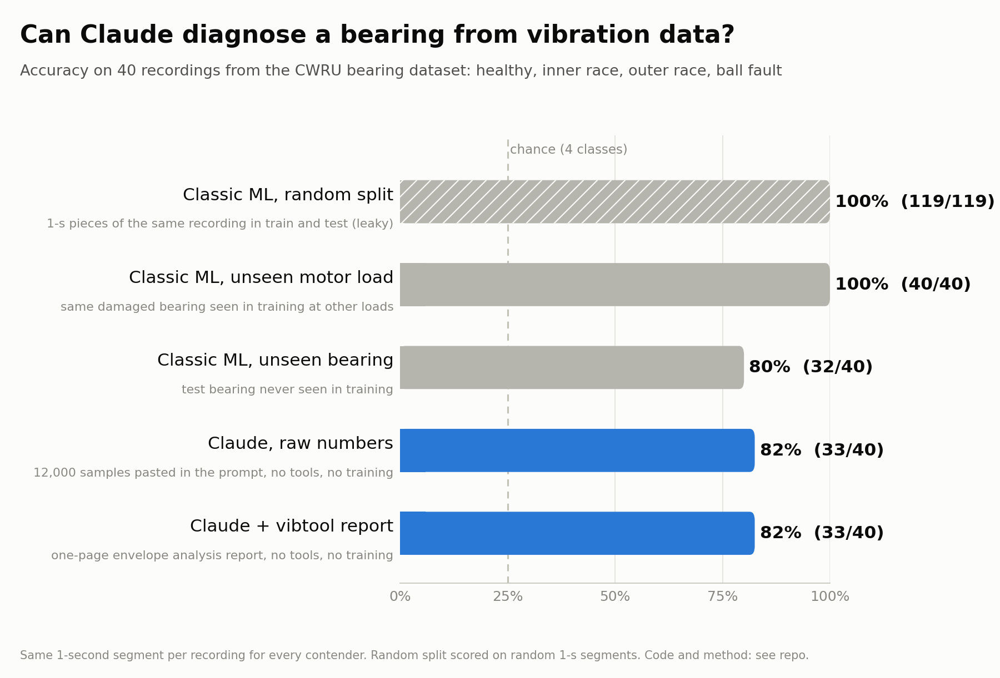

# Can Claude diagnose a bearing from raw vibration data?

A small, reproducible benchmark on the Case Western Reserve University (CWRU) bearing dataset.
Claude (Opus, run headless through Claude Code with every tool switched off) classifies 40 drive-end
vibration recordings as **normal, inner race, outer race or ball fault**. A random forest trained on
standard vibration features is the baseline to beat.

Built with Claude Code.



## Results

| Contender | Accuracy | Normal | Inner race | Outer race | Ball | Setup |
|---|---|---|---|---|---|---|
| Classic ML, random split | 100% (119/119) | | | | | 1-s pieces of the same recording in train and test (leaky) |
| Classic ML, unseen motor load | 100% (40/40) | 4/4 | 12/12 | 12/12 | 12/12 | same damaged bearing seen in training at other loads |
| Classic ML, unseen bearing | 80% (32/40) | 4/4 | 9/12 | 8/12 | 11/12 | test bearing never seen in training |
| **Claude, raw numbers** | **82% (33/40)** | 4/4 | 10/12 | 7/12 | 12/12 | 12,000 samples pasted in the prompt, no tools, no training |
| **Claude + vibtool report** | **82% (33/40)** | 4/4 | 12/12 | 8/12 | 9/12 | one-page envelope analysis report, no tools, no training |

| Claude run | Avg prompt tokens | Confidence when right | Confidence when wrong | Cost for 40 (API list price) |
|---|---|---|---|---|
| Raw numbers | 66,901 | 0.67 | 0.51 | $22.30 |
| vibtool report | 2,392 | 0.74 | 0.54 | $1.10 |

What it shows:

- **On a clean lab task, Claude matches a trained model with zero training.** 82% vs 80% is one recording: a tie.
- **It doesn't scale.** One second of one sensor is 66,901 tokens. A 1M-token context window holds under 15 seconds of one sensor.
- **Give it a tool and it gets 28x cheaper for the same accuracy.** The vibtool report version reads 2,392 tokens instead of 66,901.
- **Random splits flatter classic ML.** The same random forest scores 100% on a random split and 80% on a bearing it has never seen.
- **Everyone misses the same four recordings**: the 0.014 in outer race fault (OR014@6, files 197-200). Both Claude versions and the ML baseline get them wrong.
- **Raw-number Claude falls back to "ball" when unsure** (18 ball calls, 12 right) and is never more than 85% confident.

Every prediction, with Claude's one-sentence reasoning, is in [results/claude_predictions.jsonl](results/claude_predictions.jsonl) and [results/ml_predictions.csv](results/ml_predictions.csv). The full table is in [results/scoreboard.md](results/scoreboard.md).

## Method

**Data.** 40 recordings from the CWRU 12 kHz drive-end set: 4 healthy baselines and inner race, ball and outer race (centred, 6 o'clock) faults at 0.007, 0.014 and 0.021 in, each at motor loads 0 to 3 hp ([manifest.csv](manifest.csv)). The healthy baselines are recorded at 48 kHz and are decimated to 12 kHz. Every contender is scored on the same 1-second centre segment of each recording.

**Contenders.**

1. `claude_raw`: the 12,000 raw samples as comma-separated numbers, plus the shaft speed and the bearing defect frequencies.
2. `claude_tool`: the same context plus the output of [vibtool.py](vibtool.py) (time statistics, kurtosis-selected envelope band, envelope lines at the defect frequencies in dB above the local floor). No raw numbers.
3. `ml_*`: a random forest (500 trees) on 32 standard features, under three splits: random 1-second segments (leaky), leave-one-load-out, and leave-one-fault-size-out (unseen bearing).

No file names or labels reach the model. The answer format is a JSON object with label, confidence and a one-sentence reason.

**Isolation.** Claude runs through `claude -p` with `--tools ""` (no built-in tools), `--strict-mcp-config` (no MCP servers or connectors), `--disable-slash-commands` (no skills), `--setting-sources ""` (no user or project settings), a one-line system prompt and an empty temporary working directory. [check_isolation.py](check_isolation.py) asks the model to report everything in its context: the result ([results/isolation_check.txt](results/isolation_check.txt)) is about 950 tokens, no tools, plus a short environment block and the account email that Claude Code always attaches. Note that `--tools ""` alone does not remove MCP connectors: the first isolation check, before `--strict-mcp-config` was added, still had them loaded.

## Reproduce

```bash
pip install -r requirements.txt
python download_data.py          # fetches the 40 .mat files (140 MB) from the CWRU site into data/
python baseline_ml.py            # random forest, three splits
python check_isolation.py        # confirm the headless Claude sees only the prompt
python run_claude.py --limit 2   # smoke test
python run_claude.py             # 80 calls, resumable
python score.py                  # scoreboard + chart
```

`run_claude.py` needs the Claude Code CLI installed and logged in. The raw-number contender sends about 2.7M input tokens in total.

`vibtool.py` also works on its own:

```bash
python vibtool.py signal.csv --fs 12000 --rpm 1797
```

## Limits

- One lab rig, constant speed, one sensor, clean data, 40 recordings. Treat it as a first signal.
- CWRU is one of the most cited datasets in the field, so memorisation can't be ruled out. Claude named the dataset in 2 of its 40 report-based answers (never in the raw-number answers).
- One run per recording. LLM answers can vary between runs.
- The healthy class has only 4 recordings.

## Data

Bearing data: [Case Western Reserve University Bearing Data Center](https://engineering.case.edu/bearingdatacenter). The data is not redistributed here; `download_data.py` downloads it from the source. Please cite the CWRU Bearing Data Center if you use it.

## License

Code: MIT, see [LICENSE](LICENSE). The CWRU data belongs to Case Western Reserve University.
